<a href="https://mateomarquez.com"><picture><source media="(prefers-color-scheme: dark)" srcset="assets/tab-site-dark.svg?v=2" /><source media="(prefers-color-scheme: light)" srcset="assets/tab-site-light.svg?v=2" /></picture></a><a href="https://www.linkedin.com/in/mateo-marquez/"><picture><source media="(prefers-color-scheme: dark)" srcset="assets/tab-linkedin-dark.svg?v=2" /><source media="(prefers-color-scheme: light)" srcset="assets/tab-linkedin-light.svg?v=2" /></picture></a><a href="mailto:mateomarquezdev@gmail.com"><picture><source media="(prefers-color-scheme: dark)" srcset="assets/tab-mail-dark.svg?v=2" /><source media="(prefers-color-scheme: light)" srcset="assets/tab-mail-light.svg?v=2" /></picture></a><picture><source media="(prefers-color-scheme: dark)" srcset="https://raw.githubusercontent.com/mateomarquezdev/mateomarquezdev/output/canvas-dark.svg?v=3" /><source media="(prefers-color-scheme: light)" srcset="https://raw.githubusercontent.com/mateomarquezdev/mateomarquezdev/output/canvas-light.svg?v=3" /></picture>

