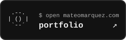
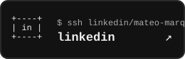

<div align="center">
  <picture>
    <source media="(prefers-color-scheme: dark)" srcset="assets/room-dark.svg" />
    <source media="(prefers-color-scheme: light)" srcset="assets/room-light.svg" />
    
  </picture>
</div>

<br/>

<div align="center">
  <picture>
    <source media="(prefers-color-scheme: dark)" srcset="assets/whoami-dark.svg" />
    <source media="(prefers-color-scheme: light)" srcset="assets/whoami-light.svg" />
    
  </picture>
</div>

<br/>

```
── stack ─────────────────────────────────────────  tap a folder
```

<details open>
<summary><b><code>backend/</code></b> &nbsp;·&nbsp; agent-01</summary>

```
├── Java · Spring Boot    REST APIs, layered services, auth, validation, tests
├── C# · .NET             APIs and business logic
└── Architecture          controllers → services → repositories
```
</details>

<details>
<summary><b><code>applied-ai/</code></b> &nbsp;·&nbsp; agent-02</summary>

```
├── Python                  my language for AI work and automations
├── LLM APIs · tool calling agents that call real tools and services
└── Automations             workflows that remove repetitive manual work
```
</details>

<details>
<summary><b><code>data/</code></b></summary>

```
├── MySQL      relational modeling and SQL
├── MongoDB    document storage when the shape changes
└── Redis      caching and short-lived state
```
</details>

<details>
<summary><b><code>cloud-ops/</code></b> &nbsp;·&nbsp; agent-03</summary>

```
├── Docker · Linux    containerized services
├── Google Cloud      deploying and running services
└── GitHub Actions    CI/CD pipelines
```
</details>

<details>
<summary><b><code>frontend/</code></b></summary>

```
└── Angular · React · TypeScript    interfaces that consume my own APIs
```
</details>

<br/>

```
── metrics ───────────────────────────────────────
```

<div align="center">
  <picture>
    <source media="(prefers-color-scheme: dark)" srcset="https://github-readme-stats.vercel.app/api?username=mateomarquezdev&show_icons=true&count_private=true&hide_border=true&bg_color=121212&title_color=EDEDED&icon_color=D97757&text_color=A3A3A3&ring_color=EDEDED" />
    <source media="(prefers-color-scheme: light)" srcset="https://github-readme-stats.vercel.app/api?username=mateomarquezdev&show_icons=true&count_private=true&hide_border=true&bg_color=FFFFFF&title_color=111111&icon_color=D97757&text_color=444444&ring_color=111111" />
    
  </picture>
  <picture>
    <source media="(prefers-color-scheme: dark)" srcset="https://github-readme-stats.vercel.app/api/top-langs/?username=mateomarquezdev&layout=compact&hide_border=true&bg_color=121212&title_color=EDEDED&text_color=A3A3A3" />
    <source media="(prefers-color-scheme: light)" srcset="https://github-readme-stats.vercel.app/api/top-langs/?username=mateomarquezdev&layout=compact&hide_border=true&bg_color=FFFFFF&title_color=111111&text_color=444444" />
    
  </picture>
</div>

<div align="center">
  <picture>
    <source media="(prefers-color-scheme: dark)" srcset="https://raw.githubusercontent.com/mateomarquezdev/mateomarquezdev/output/snake.svg" />
    <source media="(prefers-color-scheme: light)" srcset="https://raw.githubusercontent.com/mateomarquezdev/mateomarquezdev/output/snake-light.svg" />
    
  </picture>
</div>

<br/>

```
── connect ───────────────────────────────────────
```

<div align="center">
  <a href="https://mateomarquez.com"><picture><source media="(prefers-color-scheme: dark)" srcset="assets/link-site-dark.svg" /><source media="(prefers-color-scheme: light)" srcset="assets/link-site-light.svg" /></picture></a>
  <a href="https://www.linkedin.com/in/mateo-marquez/"><picture><source media="(prefers-color-scheme: dark)" srcset="assets/link-linkedin-dark.svg" /><source media="(prefers-color-scheme: light)" srcset="assets/link-linkedin-light.svg" /></picture></a>
  <a href="mailto:mateomarquezdev@gmail.com"><picture><source media="(prefers-color-scheme: dark)" srcset="assets/link-mail-dark.svg" /><source media="(prefers-color-scheme: light)" srcset="assets/link-mail-light.svg" /></picture></a>
</div>

<br/>

<p align="center"><sub>agents: fan art of Clawd, the Claude Code mascot by Anthropic · non-commercial</sub></p>
