<div align="center">
  <picture>
    <source media="(prefers-color-scheme: dark)" srcset="assets/room-dark.svg" />
    <source media="(prefers-color-scheme: light)" srcset="assets/room-light.svg" />
    
  </picture>
</div>

<br/>

<div align="center">
  <picture>
    <source media="(prefers-color-scheme: dark)" srcset="assets/whoami-dark.svg" />
    <source media="(prefers-color-scheme: light)" srcset="assets/whoami-light.svg" />
    
  </picture>
</div>

<br/>

```
── stack ──────────────────
```

<details open>
<summary><b><code>backend/</code></b> · agent-01</summary>

```
├── Java · Spring Boot
│   REST APIs, auth, tests
├── C# · .NET
│   APIs, business logic
└── Architecture
    controller → service → repo
```
</details>

<details>
<summary><b><code>applied-ai/</code></b> · agent-02</summary>

```
├── Python
│   AI work, automations
├── LLM APIs · tool calling
│   agents that use real tools
└── Automations
    no more repetitive work
```
</details>

<details>
<summary><b><code>data/</code></b></summary>

```
├── MySQL     relational, SQL
├── MongoDB   documents
└── Redis     caching
```
</details>

<details>
<summary><b><code>cloud-ops/</code></b> · agent-03</summary>

```
├── Docker · Linux
├── Google Cloud
└── GitHub Actions  CI/CD
```
</details>

<details>
<summary><b><code>frontend/</code></b></summary>

```
└── Angular · React · TS
```
</details>

<br/>

```
── metrics ────────────────
repos ........ 22
on github .... since 2022
stack ........ 16 tools
agents ....... 4 online
```

<div align="center">
  <picture>
    <source media="(prefers-color-scheme: dark)" srcset="https://raw.githubusercontent.com/mateomarquezdev/mateomarquezdev/output/activity-dark.svg" />
    <source media="(prefers-color-scheme: light)" srcset="https://raw.githubusercontent.com/mateomarquezdev/mateomarquezdev/output/activity-light.svg" />
    
  </picture>
</div>

<div align="center">
  <picture>
    <source media="(prefers-color-scheme: dark)" srcset="https://raw.githubusercontent.com/mateomarquezdev/mateomarquezdev/output/snake.svg" />
    <source media="(prefers-color-scheme: light)" srcset="https://raw.githubusercontent.com/mateomarquezdev/mateomarquezdev/output/snake-light.svg" />
    
  </picture>
</div>

<br/>

```
── connect ────────────────
```

<div align="center">
  <a href="https://mateomarquez.com"><picture><source media="(prefers-color-scheme: dark)" srcset="assets/link-site-dark.svg" /><source media="(prefers-color-scheme: light)" srcset="assets/link-site-light.svg" /></picture></a>
  <a href="https://www.linkedin.com/in/mateo-marquez/"><picture><source media="(prefers-color-scheme: dark)" srcset="assets/link-linkedin-dark.svg" /><source media="(prefers-color-scheme: light)" srcset="assets/link-linkedin-light.svg" /></picture></a>
  <a href="mailto:mateomarquezdev@gmail.com"><picture><source media="(prefers-color-scheme: dark)" srcset="assets/link-mail-dark.svg" /><source media="(prefers-color-scheme: light)" srcset="assets/link-mail-light.svg" /></picture></a>
</div>
