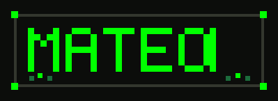

  

  

  
  
  
  

 

  

 

## `~/knowledge`

  

 

> [!TIP]
> Click each module to open it ↓

<b>☕ Backend</b> &nbsp;<code>java</code> <code>spring</code> <code>.net</code>

 

  
  
  
  

- REST APIs and services with **Spring Boot** and **.NET**
- Layered architecture: controllers → services → repositories
- Auth, validation, error handling and testing

<b>🤖 Applied AI &amp; Agents</b> &nbsp;<code>python</code> <code>llms</code> <code>agents</code>

 

  

- Agents that use **tool calling** to act on real systems
- Connecting **LLM APIs** with internal tools, data and workflows
- Automations that remove repetitive manual work

<b>🗄️ Data</b> &nbsp;<code>mysql</code> <code>mongodb</code> <code>redis</code>

 

  
  
  

- Relational modeling and SQL queries
- Document stores for flexible data
- Caching with Redis

<b>☁️ Cloud &amp; DevOps</b> &nbsp;<code>docker</code> <code>linux</code> <code>gcp</code>

 

  
  
  
  
  

- Containerized services with Docker
- Deploys on Google Cloud
- CI/CD with GitHub Actions

<b>🎨 Frontend</b> &nbsp;<code>angular</code> <code>react</code>

 

  
  
  

- Interfaces that consume my own APIs end to end

 

## `~/stats`

  
  

  

 

  <picture>
    <source media="(prefers-color-scheme: dark)" srcset="https://raw.githubusercontent.com/mateomarquezdev/mateomarquezdev/output/snake.svg" />
    <source media="(prefers-color-scheme: light)" srcset="https://raw.githubusercontent.com/mateomarquezdev/mateomarquezdev/output/snake-light.svg" />
    
  </picture>

  <code>❯ exit</code> &nbsp;·&nbsp; thanks for stopping by

